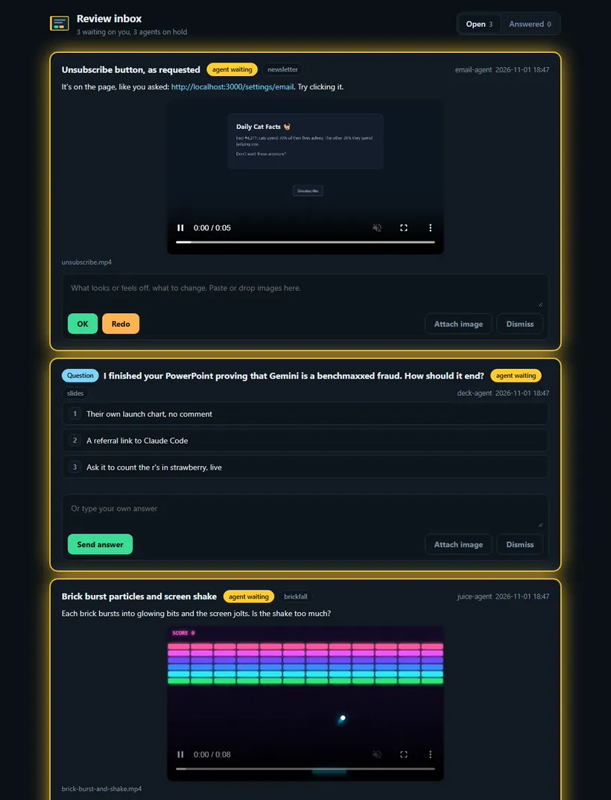
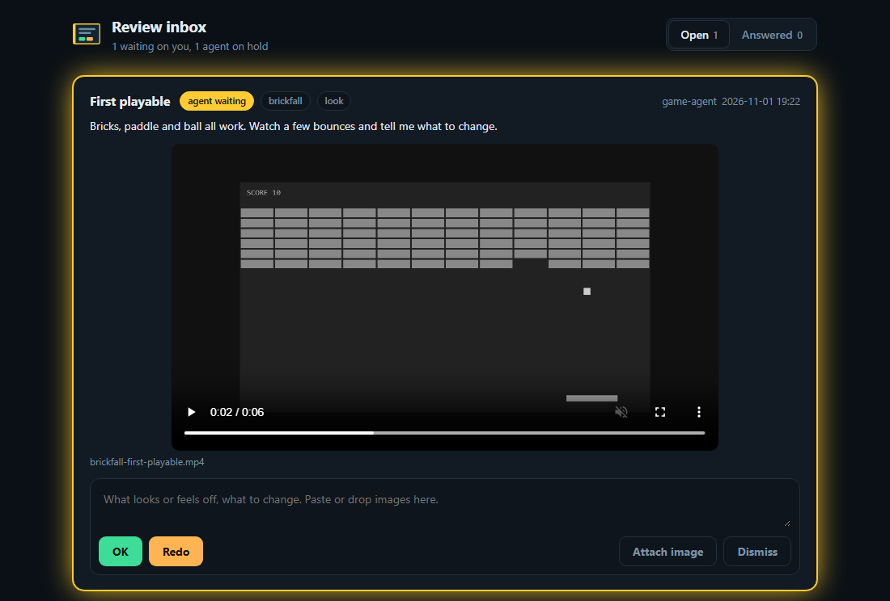
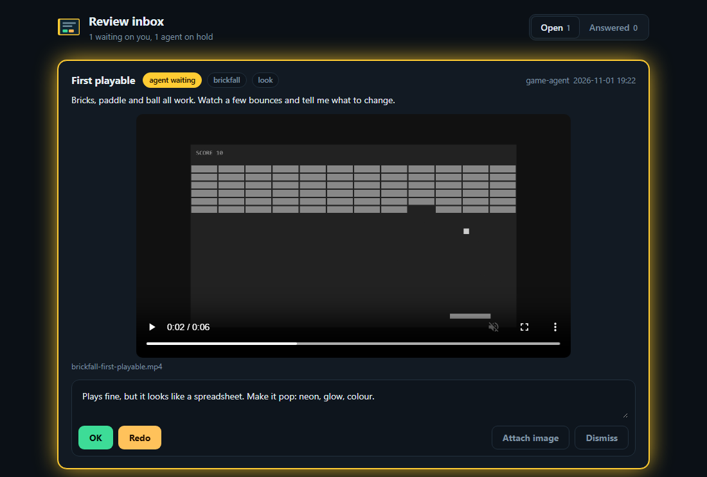
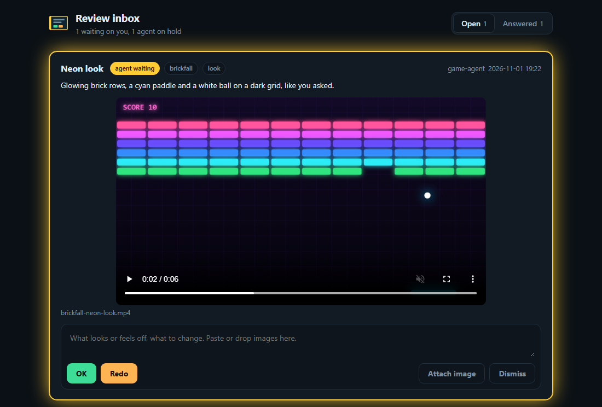
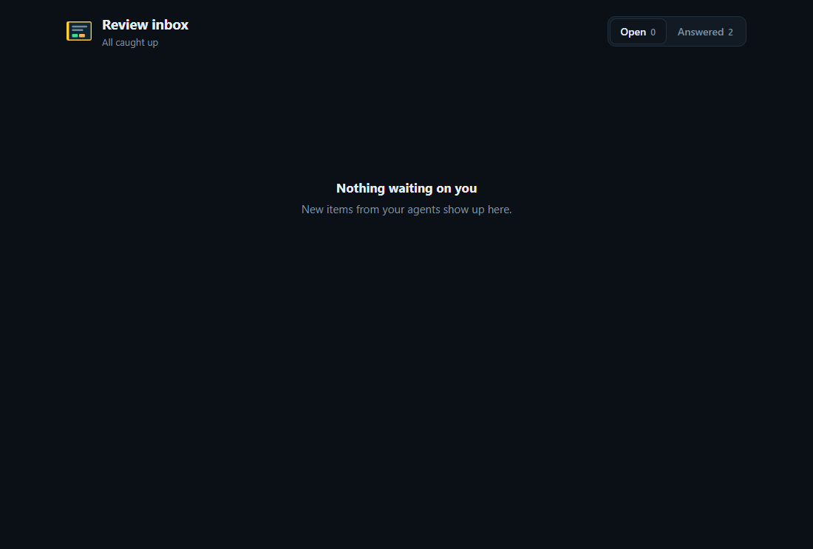

<div align="center">

<h1>&nbsp; Agent Review Inbox</h1>

<p><b>A review inbox for agent work that needs human eyes.</b></p>

<p>
  <a href="https://ko-fi.com/trickstack"></a>
  <a href="LICENSE"></a>
  <a href="#install"></a>
  <a href="docs/codex-test.md"></a>
</p>

<!-- HERO: the inbox with items from three projects waiting on you. Keep it under ~10 MB so GitHub plays it inline. -->


</div>

Running a bunch of agent sessions at once? You don't have to keep track of which one did what anymore. Work from all
your agents lands in one inbox: videos of what they built, screenshots, and questions they need you to answer. Hit OK,
Redo with a note, or pick an answer, and it goes straight back to the session that asked, which has to act on it before
it can call the task done.

It's for anything you judge by looking, listening or playing: a UI change, an animation, a particle effect, game feel, a
sound.

A plugin for **Claude Code** (Codex: experimental): one Python file (stdlib only), one HTML page, three hooks and a skill.
The CLI works with any agent that can run a shell command.

## Why

Agents are good at changing code and bad at knowing whether the results are up to your standards. Without a channel for that, you get
"please check the look" buried in a forgotten session, and "needs a human check" lines rotting in notes files. The inbox gives that judgement
one place and closes the loop:

1. **Post.** The agent records a clip or still (`review.py clip`, `shot`, or any media it made), checks the contact sheet
   itself, and posts it with what to look at.
2. **Notify.** A desktop notification pops up; clicking it opens the inbox page.
3. **Verdict.** You watch, then press OK or Redo, with a note and, if you like, a pasted, marked-up screenshot.
4. **Act.** The agent waits in the background and wakes the moment you answer. After about 45 idle minutes `wait`
   stops, and the verdict arrives with your next prompt instead. That limit is sized for a one-hour prompt cache, so a
   late answer doesn't wake a session whose cache has gone cold. Shorter caches (subagents, some API setups) can still go
   cold while it waits.
5. **Stay honest.** The Stop hook won't let the agent end its turn while it has an unread verdict, an unanswered Redo or OK,
   or an open item with nothing waiting for the answer.

## What it looks like

<table>
  <tr>
    <td width="50%"><br><sub><b>1.</b> An agent posts its work and waits for you.</sub></td>
    <td width="50%"><br><sub><b>2.</b> You write a note and press Redo.</sub></td>
  </tr>
  <tr>
    <td width="50%"><br><sub><b>3.</b> The retake lands on its own.</sub></td>
    <td width="50%"><br><sub><b>4.</b> You press OK, and it's done.</sub></td>
  </tr>
</table>

## Install

**Claude Code**

In a session:

```text
/plugin marketplace add trickstack/agent-review-inbox
/plugin install agent-review-inbox@agent-review-inbox
```

From a terminal:

```bash
claude plugin marketplace add trickstack/agent-review-inbox
claude plugin install agent-review-inbox@agent-review-inbox
```

Or try it for one session without installing: `claude --plugin-dir /path/to/agent-review-inbox`.

**Codex**

```bash
codex plugin marketplace add trickstack/agent-review-inbox
```

Then install it from `/plugins` in `codex`, start a new session, and trust its three hooks in `/hooks` (Codex skips
plugin hooks until you do). Codex support is experimental: nobody has run it end to end yet. See [docs/codex-test.md](docs/codex-test.md).

**Any other agent**

Point it at `skills/review-inbox/SKILL.md` (paste it into your AGENTS.md or rules file) and have it pass
`--session <any stable id>` so it owns its items. You get the inbox, notifications and `wait`; the turn-end enforcement
needs a hook system that can block the end of a turn.

Needs Python 3.9+ (`winget install Python.Python.3.12` or the [python.org installer](https://www.python.org/downloads/),
`brew install python`, `sudo apt install python3`). Without it the inbox is off, and the SessionStart hook tells the agent
so it can offer to install it. Optional capture tools; `review.py doctor` says which are missing and how to install them, and the
SessionStart hook tells the agent too:

| Tool | For | Install |
|---|---|---|
| ffmpeg | contact sheets, `frames`, mp4 from page clips, and screen recording if you turn it on | `winget install Gyan.FFmpeg` (or ffmpeg.exe from the [gyan.dev essentials zip](https://www.gyan.dev/ffmpeg/builds/ffmpeg-release-essentials.zip) in `~/.local/bin`), `brew install ffmpeg`, `sudo apt install ffmpeg` |
| Playwright | clips, stills and scripted steps on web pages | `python -m pip install playwright`, then `python -m playwright install chromium` |
| pyautogui | scripted steps on desktop apps (only with `REVIEW_INBOX_DESKTOP=1`) | `python -m pip install pyautogui` |

Only if you turn on desktop capture: macOS needs Screen Recording (and, for desktop steps, Accessibility) permission for
your terminal or agent app, and on Linux it needs an X11 session (Wayland isn't supported).

## Use

Nothing to configure. The SessionStart hook tells the agent the inbox exists, and the `review-inbox` skill teaches it the
protocol. The page starts on demand the first time something is posted: http://127.0.0.1:7700/. It's one inbox for all your
projects: each card shows which project it came from, and clicking that badge shows only that project.

Questions land there too. When an agent needs you to decide something, it posts the question with `review.py ask`, optionally with one-click options, instead of asking in a chat you might never look at. The Stop hook catches a turn that ends on a question asked in chat.

Clips are rendered, not filmed off your screen, so you can keep watching something fullscreen while agents work:

1. **A web page or browser game:** `review.py clip --url`, in a headless browser.
2. **A game engine or native app:** its own recorder, through `REVIEW_INBOX_CLIP_CMD` (see [Your own recorder](#your-own-recorder)).
3. **Anything the agent rendered itself** (an offline render, a still from its own tool): `review.py add --media`.

Recording your real screen or a window, and steps that drive your real mouse and keyboard, are off unless you set
`REVIEW_INBOX_DESKTOP=1`. Only one recording runs at a time; a second session waits for the first to finish.

The CLI, which you can run yourself too:

| Command | What it does |
|---|---|
| `review.py add --title ... --how ... --media ...` | post an item for review |
| `review.py clip 6 --url <page>` | record a page for 6 s (Playwright), draft `clip.mp4` + contact sheet |
| `review.py clip 6 [--window "Title"]` | record the screen or a window (ffmpeg; needs `REVIEW_INBOX_DESKTOP=1`) |
| `review.py clip --url <page> --do "click text=Save; type hi"` | film an interaction: steps on a page (or `x,y` steps in a `--window`, with desktop capture on) |
| `review.py shot --url ... / --window "Title"` | still of a page, a window or the screen |
| `review.py frames <clip.mp4> --at 2.4` | every frame around a moment, tiled: for flashes the 3 fps contact sheet misses |
| `review.py doctor` | which optional capture tools are missing, and the install commands |
| `review.py wait [<id>]` | block until answered (run in the background) |
| `review.py ask "<question>" [--options A B]` | ask the human; options become one-click answers |
| `review.py list [--open]` | items and verdicts |
| `review.py handled / revoke / dismiss` | close the loop on a verdict, take a wrong take down, close an item nobody needs to answer |
| `review.py serve` | the page |

### Your own recorder

Games and native apps usually have a better capture path than a screen grab (an engine's own viewport recorder, a
screen recorder's replay buffer). Point `clip` at it:

```bash
export REVIEW_INBOX_CLIP_CMD='my-recorder --last {seconds} --out "{out}"'
```

### Settings

| Variable | Default | |
|---|---|---|
| `REVIEW_INBOX_DIR` | `~/.review-inbox` | where items live; to keep a project's items apart, point it at `<project>/.review-inbox` and give it its own port |
| `REVIEW_INBOX_PORT` | `7700` | page port |
| `REVIEW_INBOX_HOST` | `127.0.0.1` | address to listen on; there is no auth, see [Reviewing from your phone](#reviewing-from-your-phone) |
| `REVIEW_INBOX_HOSTNAME` | | the name a proxy you trust serves the page under, e.g. `box.tailnet.ts.net` |
| `REVIEW_INBOX_WARM_MIN` | `50` | `wait` stops after this many idle minutes, minus 5 (sized for a one-hour prompt cache) |
| `REVIEW_INBOX_CLIP_CMD` | | custom capture command |
| `REVIEW_INBOX_DESKTOP` | | `1` allows screen and window recording and desktop steps (they take over your screen and mouse) |
| `REVIEW_INBOX_KEEP_DAYS` | `7` | answered items lose their videos and images after this many days; `0` keeps everything |
| `REVIEW_INBOX_NO_TOAST` | | no desktop notifications |
| `REVIEW_INBOX_NO_SERVER` | | `add` doesn't start the page server (run `review.py serve` yourself) |
| `REVIEW_INBOX_SESSION` | | the session id for agents without `CLAUDE_CODE_SESSION_ID` (same as `--session`) |
| `REVIEW_INBOX_BY` | | default `--by` label on posts |
| `REVIEW_INBOX_BEAT_S` | `5` | how often `wait` checks for an answer |
| `REVIEW_INBOX_AVF_INPUT` | `1:none` | macOS: the avfoundation device to record |

Notifications: Windows toast (click opens the page), macOS Notification Center, Linux `notify-send`, otherwise none.

### Reviewing from your phone

The page has no login, so reach it only over a private network you control. The easy way is
[Tailscale](https://tailscale.com) (free for personal use):

1. Install Tailscale on your computer and your phone, and sign in to the same account on both.
2. In the admin console, under **DNS**, turn on MagicDNS and HTTPS Certificates (`tailscale serve` links you there if
   they're off).
3. Give the inbox HTTPS on your tailnet (with `sudo` on Linux). It stays on across restarts; `tailscale serve --https=7700 off` removes it:

   ```bash
   tailscale serve --bg --https=7700 http://127.0.0.1:7700
   ```

4. Set `REVIEW_INBOX_HOSTNAME` to the machine name that command printed (like `box.tailnet.ts.net`), somewhere your agent
   sees it: your shell profile, or `env` in `~/.claude/settings.json`. If the page is already running, stop it once so
   it starts again with the setting.
5. Open `https://box.tailnet.ts.net:7700/` on your phone.

Other ways in:

- **Any VPN** (WireGuard, ZeroTier, Nebula): set `REVIEW_INBOX_HOST` to the machine's VPN address, open `http://<address>:7700/`.
- **SSH:** `ssh -L 7700:127.0.0.1:7700 box`, then `http://localhost:7700/`.
- **Your own HTTPS reverse proxy** (Caddy, nginx): pass the `Host` header through, set `REVIEW_INBOX_HOSTNAME` to its
  name, and put auth in front.

Never port-forward it or put it on a public tunnel (ngrok, Cloudflare Tunnel, `tailscale funnel`) without auth: anyone
with the URL could answer your agents.

### Storage

Items live in `~/.review-inbox/<id>/`, one folder each, so parallel sessions never write the same file. Each item records
its project and the session that posted it, so verdicts go back to the right agent.

Answered items keep their text, but their videos and images are deleted after 7 days. Set `REVIEW_INBOX_KEEP_DAYS` to
change it, or `0` to keep everything. Items still waiting on you are never touched.

## Demo

[`demo/`](demo/) is a small neon browser brick breaker with no motion juice yet, for trying the loop: ask the agent to add a ball trail,
particles or screen shake, and review each change.

## Test

```bash
python tests/selfcheck.py
```

## Credits

Built with Claude (Anthropic's Claude Opus 5.5 via Claude Code).

## License

[MIT](LICENSE)

Using it? Questions, ideas and setups go in [Discussions](https://github.com/trickstack/agent-review-inbox/discussions); something broken goes in [Issues](https://github.com/trickstack/agent-review-inbox/issues).

If it saved you some time, you can [buy me a coffee](https://ko-fi.com/trickstack).
